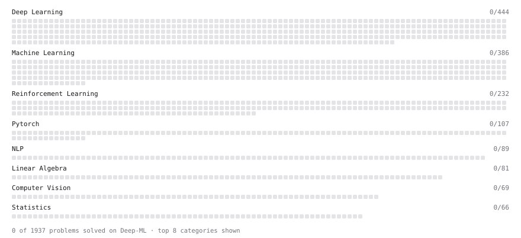

# Deep-ML

My machine learning practice from [Deep-ML](https://www.deep-ml.com). Every solution here was written by hand.

**2** solved · 1 problems · 1 labs · 0 math

[**Browse the interactive portfolio**](https://zeusgod230.github.io/deep-ml/) to replay this filling in over time.

## Problems

| | Difficulty | Solved | |
| --- | --- | --- | --- |
| [Feature Scaling Implementation](https://www.deep-ml.com/problems/16) | easy | 2026-11-07 | [solution](problems/0016-feature-scaling-implementation) |

## Labs

| | Difficulty | Solved | |
| --- | --- | --- | --- |
| [Design Your Own Activation Function](https://www.deep-ml.com/labs/9) | easy | 2026-11-07 | [solution](labs/0009-design-your-own-activation-function) |

---

_This file is regenerated by Deep-ML on every push._
